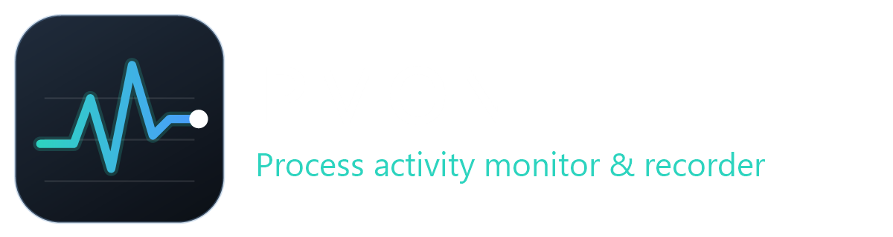

<p align="center">
  
</p>

# PMON

**Find out what your processes were doing when everything slowed down.**

PMON is a Windows process activity monitor and recorder. Point it at the processes you suspect, let it record in the background, and when a slowdown or odd behaviour happens, scrub back through the recording to see exactly what those processes (and everything else on the machine) were doing at that moment.

## What it does

- **Tracks processes by rule.** Add wildcard patterns (`chrome*`, `*sql?`) or regular expressions (`re:^code( helper)?$`) to follow whole families of processes, and exclude rules to carve out the noise. Rules are re-checked on every sample, so processes that start later are picked up automatically.
- **Records to CSV.** One row per system sample and one per tracked process, in a single plain file you can open in Excel or load into your own tooling. Recording can start automatically when PMON launches.
- **Charts it live.** Tabbed graphs for overview, CPU, memory, disk I/O, and handles and GUI objects, with a hover cursor that reads off exact values.
- **Drills into one process.** The Process detail tab shows all of a process's metrics together, plus a window state timeline.
- **Catches the culprit.** Optionally records the busiest processes you are *not* tracking (top CPU, memory and disk users), so a system-wide spike can be traced back to its cause.
- **Replays recordings.** Open any recording and scrub through it with the timeline selector. The charts, readouts and process list all move to that point in time.

## What it measures

| Scope | Metrics |
|---|---|
| System | CPU load, physical memory use, commit charge, disk busy %, disk read/write throughput |
| Per process | CPU %, thread count, handles, GDI and USER objects, base priority |
| Memory | Working set (and peak), private bytes, page file usage, virtual size, page faults per second |
| Disk | Read and write bytes per second, I/O operations per second |
| Activity | Foreground or background, minimised, window position and size, window title, responding or hung |

Process CPU is shown as a share of all cores, so 100% means the whole machine.

## Using it

1. **Add rules.** Click *Edit rules…*, start typing a process name (for example `edge`) and pick from the running processes. Use *Track* to follow it or *Exclude* to ignore it. The window previews what a pattern matches before you add it.
2. **Record.** Press *Start recording*. Files are saved to `Documents\PMON\Recordings` by default.
3. **Explore.** Use the tabs for the metric you care about. The *Processes* button chooses which processes are drawn; on the *Process detail* tab, the picker chooses the process to inspect.
4. **Look back.** *Open recording…* loads a CSV. Drag the timeline to move through it, and pick a time window from the toolbar.

Settings (rules, sample interval, window span, recording folder) are saved to `%APPDATA%\PMON\settings.json`.

## Building

Requires the .NET 10 SDK on Windows.

```powershell
npm run build:debug     # debug build
npm start               # build and run
npm run build:release   # self-contained single-file executable in dist\
npm run start:release   # run the release build
npm run assets          # regenerate the icon and logo
```

Release builds are standalone: no .NET runtime is needed on the target machine.

Built with [Avalonia UI](https://avaloniaui.net/) and .NET 10.

## Author

Mehuge
